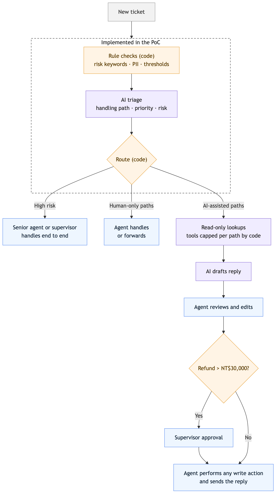

# Travel Agency Customer Support AI — Deployment Case Study

An end-to-end analysis of bringing AI-drafted replies into the customer-support operation of a mid-size travel e-commerce company — scoping, solution design, metrics, and launch gates under data-privacy, system-access, and staffing constraints — plus a runnable PoC of the first rollout stage, ticket triage.

> **Simulated scenario** from a senior field-deployment engineering assignment. The company, stakeholders, and 48 sample tickets are fictional.

**[Report](docs/case-study.md)** · **[PoC](poc/)**

## The situation

- About 350 text tickets a day (double in peak season), handled manually by 8 agents
- First response averages 6 hours and often exceeds 24 hours in peak season; complaints are rising
- The support lead wants AI to auto-reply and cut headcount in half
- Customer data may not go to any external service that has not been reviewed, and no LLM provider is contracted
- Order data sits behind an internal API with access review and a low QPS limit; knowledge is scattered across outdated documents

## What was built vs. designed

| Scope | Status |
|---|---|
| LLM classification, field extraction, rule merge, and routing | Implemented in the PoC |
| Per-path ceiling on the tools the model requests | Implemented as a filter; the tools themselves are stubs |
| Order API, policy retrieval, drafting, and the agent interface | Designed only |
| Discovery with agents, a labeled evaluation set, and a pilot | Not yet run |

## Key decisions

| Decision | Why |
|---|---|
| **AI triage + drafts with agent review**, not fully automatic replies | Large refunds need supervisor approval, and legal or PR threats need human judgment; a wrong reply costs more than the time saved |
| **Triage by what happens next**: handling path, priority, risk flags | Topic categories do not tell an agent which systems to check or how urgent a ticket is |
| **Code owns business rules; AI owns understanding** | Refund thresholds, departure deadlines, and risk keywords must be deterministic. AI can escalate rule flags but never clear them |
| **Least-privilege tools** | AI requests lookups and code approves them against a per-path ceiling; AI never writes to the order system, which limits the blast radius of a prompt injection by design |
| **Local open-source model until legal approves a vendor** | Keeps customer data in-house while the vendor review runs in parallel |
| **Staged rollout with rollback by step** | Advisory triage → lookups → drafting, path by path; errors turn off only the failing step |
| **No headcount reduction promised** | Across optimistic and conservative assumptions, capacity stays well below peak-season volume |

## Workflow overview

Orange is code, purple is AI, blue is human. The dashed box is what the PoC implements. The full workflow, including exception paths, is in the [report](docs/case-study.md#41-end-to-end-workflow).

## The PoC: ticket triage, the first rollout stage

Triage ships first because it does not depend on order-API access or curated policy knowledge, and it gets urgent and cross-department tickets handled sooner. The PoC is a runnable triage pipeline over the 48 sample tickets, combining a local `qwen3:8b` model (via Ollama) with deterministic rules.

- **2** tickets suggested for archiving (spam, test data); **46** remain as support tickets
- **23** are marked for AI-assisted paths, where later stages would allow AI lookups and drafts; **23** are marked human-only
- **11** tool requests from the model (8 tickets) were filtered out by the per-path ceiling. This shows the filter is applied; it does not test real API authorization or resistance to prompt injection
- **No accuracy figure yet:** there is no labeled evaluation set. Observed failure modes, such as over-broad urgency flags and tickets whose wording hides the real request, are documented in the [report](docs/case-study.md#6-poc-ticket-triage)

Run instructions, trade-offs, and limitations: [`poc/README.md`](poc/README.md)

## What's inside

| Path | Content |
|---|---|
| [`docs/case-study.md`](docs/case-study.md) | Full report: assessment of options, problem definition, solution design, metrics and launch gates, PoC findings, hypothetical pilot incident review |
| [`poc/`](poc/) | Triage PoC: code, unit tests, sample data, and output |
| [`docs/figures/`](docs/figures/) | Diagrams (Mermaid sources and rendered PNGs) |
