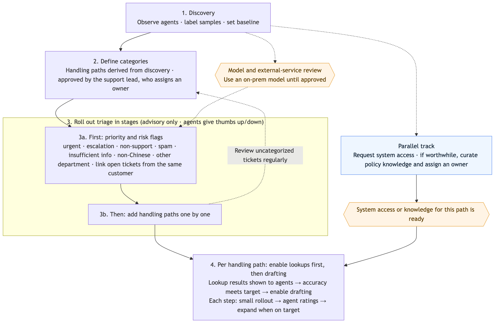
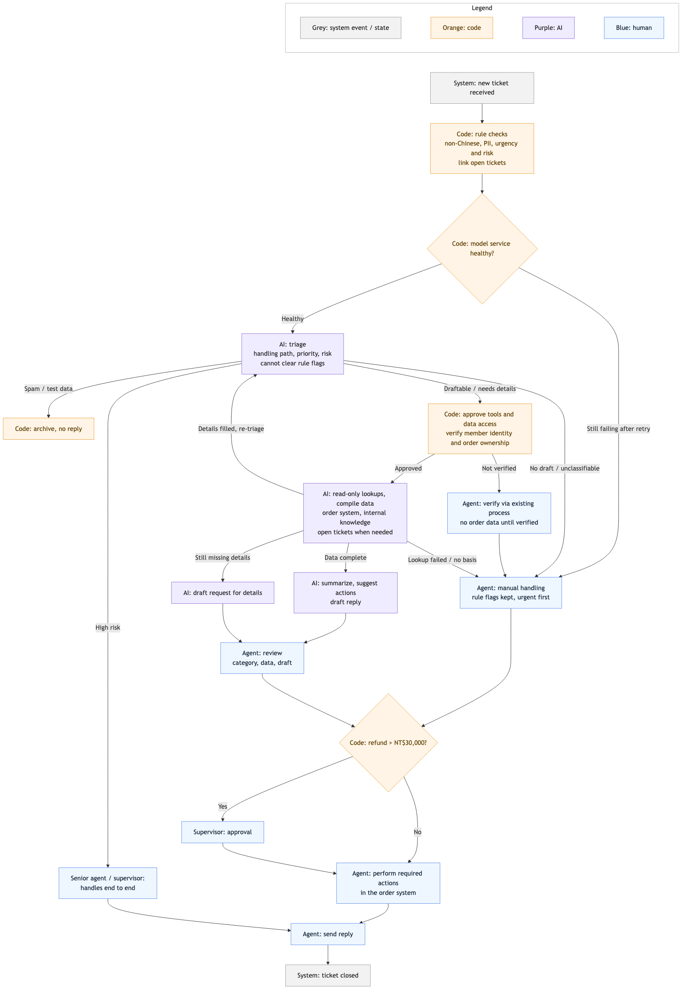

# Travel Agency Customer Support AI — Deployment Analysis

> **Simulated scenario** from a senior field-deployment engineering assignment. The company, stakeholders, and 48 sample tickets are fictional. This document is the full deployment analysis; the runnable PoC of the first rollout stage, ticket triage, is in [`poc/`](../poc/).

## TL;DR

- **Recommendation:** AI triages, looks up data, and drafts replies; agents review before anything is sent. Fully automatic replies are not recommended now, and a standalone knowledge-base tool is built only if discovery shows it is worth it.
- **Triage by what happens next, not by topic:** handling path (which data and who handles it), priority, and risk flags.
- **Code owns business rules, AI owns understanding:** refund-approval thresholds, departure deadlines, risk keywords, and tool and data permissions are deterministic. The model can escalate rule flags but never clear them, and it never writes to business systems.
- **Data stays in-house** until legal and security approve an external provider, so the PoC runs on a local open-source model.
- **Human-verified gates:** supervisors or senior agents audit whether first replies were correct, useful, and on time; error rates count only explicit errors reported by agents. Triage → lookups → drafting open path by path, and a failure turns off only the affected feature.
- **Capacity check:** with an optimistic 30% time saving on draftable tickets, daily capacity rises to about 500 tickets, enough for about 350 a day in normal season but about 200 short of peak volume. There is no basis to promise a headcount reduction.

**What was built vs. designed**

| Scope | Status |
|---|---|
| LLM classification, field extraction, rule merge, and routing | Implemented in the PoC |
| Per-path ceiling on the tools the model requests | Implemented as a filter; the tools themselves are stubs |
| Identity and order-ownership checks, order API, knowledge retrieval, drafting, and the agent interface | Designed only |
| Discovery with agents, a labeled evaluation set, and a pilot | Not yet run |

Sections 2–5 are the design; section 6 reports what the PoC showed; section 7 is a hypothetical pilot scenario.

## 1. Context

A mid-size travel e-commerce company receives about 350 text tickets per day by email and web form, roughly double in peak season. Eight agents handle them manually: read, look up systems, reply. Average first response time is 6 hours and often exceeds 24 hours in peak season, and complaints and negative reviews are rising.

| Stakeholder | Position or constraint |
|---|---|
| Support lead | Wants AI to auto-reply and cut headcount in half; estimates 40% order, 30% product, 20% refund or change, 10% other |
| IT | Order system has an internal REST API (lookups, refund requests) behind an access review and a low QPS limit; knowledge is scattered across Word, Excel, and an unmaintained FAQ page; the ticketing system has an API and webhooks |
| Legal and security | Customer personal data must not go to external services that have not been reviewed and contracted; no LLM provider is contracted yet |
| Senior agent | Many tickets require two or three systems; refunds above NT$30,000 need supervisor approval; what customers write often differs from what they need |

The support lead proposed three options:

- **(A)** AI replies to every ticket automatically
- **(B)** AI triages and drafts replies; agents review before sending
- **(C)** An internal knowledge-base Q&A tool for agents

## 2. Assessment

### 2.1 What the sample tickets show

A ticket-by-ticket review of the 48 samples did not match the interview picture:

- About 15% were not support tickets at all: job applications, sponsorship pitches, vendor quotes, press requests, and spam.
- About one in six was urgent, for example a typhoon the day before departure, a duplicate charge with a chargeback threat, or threats to go to the consumer protection office or the media.
- Some tickets contained personal data (TK-1023 includes a national ID and bank account number), and some stated a request that differed from the real need (TK-1004 complains that nobody answered the phone but actually wants the itinerary).

### 2.2 Triage dimensions

Topic categories alone do not answer "what happens next for this ticket", so triage uses three dimensions:

- **Handling path:** which data is needed and who handles it.
- **Priority:** for example, departing within 72 hours or currently traveling.
- **Risk flags:** for example, an amount above NT$30,000, legal or PR exposure, or personal data.

The actual paths come from **discovery**: observe how agents answer tickets, and have senior agents label each ticket type's handling steps, required data, systems checked, applicable policies, and responsible role, with historical timestamps as the baseline. The results define the categories, the tools and access ceiling for each path, and which step is most worth improving.

### 2.3 Evaluating the three options

**Shared conditions.** External contractors sign an NDA, and unmasked tickets stay inside the company environment. The model and any external service that touches ticket data must pass legal and security review and be contracted before it receives data.

**(A) Fully automatic replies — not recommended now.**

- *Fit:* large refunds, compensation, and legal or PR cases still need human judgment, so full automation does not fit.
- *Risk:* situations vary and nothing has been measured yet; a wrong reply can cost compensation and reputation.
- *Prerequisite:* accumulate data from (B), then evaluate category by category, with human review, what could be answered automatically.

**(B) AI triage and drafts, agents review — recommended.**

- *Fit:* agents often check two or three systems per ticket. AI can extract information, look up data in advance, and draft from policy, while agents keep the final check.
- *Risk:* misreading the need sends lookups and drafts in the wrong direction; the order-API access review can delay the timeline.
- *Prerequisites:* discovery clarifies the process and categories, and read access to the required APIs is granted. AI only looks up, suggests, and drafts; agents perform all write actions.

**(C) Internal knowledge-base Q&A — depends on discovery.**

- *Fit:* suited to internal knowledge that changes little and has a confirmable valid version, such as policies and standard operating procedures. If finding this knowledge really costs agents time and curating it is worth the cost, integrate it into (B) rather than building a separate tool.
- *Risk:* conflicting document versions lead to wrong citations; without an owner, accuracy decays.
- *Prerequisites:* confirm the valid versions, clean out outdated or conflicting content, and assign an owner and an update process.

### 2.4 What not to solve with AI

- **Policy version governance:** the business owner confirms which version is valid; AI only helps convert it into a searchable format.
- **Approval for refunds above NT$30,000:** code checks the threshold and routes to a supervisor; AI does not decide whether approval is needed.
- **Long phone wait times:** a phone-staffing and systems issue to report to management separately.
- **Visas, passport validity, and weather rules:** based on official government and airline sources and confirmed by agents; AI does not decide them.
- **Business outside customer support:** job applications, sponsorships, vendor quotes, and press requests are routed to the owning department; the support AI does not judge or answer for that department.

### 2.5 What not to solve yet

- **Fully automatic replies:** evaluate category by category once (B) has enough quality and risk data.
- **Halving headcount:** not promised now. Every reply still needs human review; first verify the improvement in handling time and first response. See the capacity limit in §3.5.
- **Curating fast-changing internal knowledge:** product details, itineraries, prices, and inclusions are not turned into another knowledge base that must be kept in sync. Agents keep using the current sources; connecting directly to source systems can be evaluated later.

### 2.6 Rollout order

Orange marks external prerequisites; blue marks the parallel track.

1. **Discovery.** Clarify the process, data needs, and time spent, and set the baseline. In parallel, confirm API access, QPS, and the model-review timeline, and decide whether policy knowledge is worth integrating, to avoid building in the wrong direction.
2. **Define categories.** Derive handling paths from discovery. I propose; the support lead approves and assigns an owner, so categories match the real work.
3. **Roll out triage in stages.** Start with priority, risk, and detection of non-support, spam, insufficient-info, non-Chinese, and other-department tickets, and link open tickets from the same customer; this does not wait for every handling path to be defined. Then add handling paths one at a time. Results are advisory at first, agents mark them right or wrong, and uncategorized tickets are reviewed regularly.
4. **Per path, enable lookups before drafting.** Once a path's access and knowledge are ready, first show agents the lookup results with sources to verify; enable drafting only after lookup accuracy meets the target. Validating the two stages separately makes errors locatable. Each starts small and expands only after ratings meet the target.

**Parallel work:** access requests start with discovery; if policy knowledge is worth integrating, it is curated in parallel with a named maintainer. Until the model and external-service review is done, development uses an open-source model deployed inside the company; I provide a cost, latency, and quality comparison of deployment options for legal and security to decide.

### 2.7 Response to the support lead's request

The support lead wants automatic replies and half the headcount. The recommendation is to use (B) first to shorten first response time and reduce complaints and negative reviews, keeping those two requests as long-term goals pursued category by category once quality is stable.

## 3. Problem Definition

**Problem statement:** use AI triage, advance lookups, and drafting to cut the time agents spend searching across systems and writing replies, shorten first response, and reduce complaints and negative reviews caused by slow replies. Human review stays in place, and no headcount reduction is promised now.

### 3.1 Goals and non-goals

**Goals**

- **Outcome:** shorter first response time, measured separately for normal season, peak season, and urgent tickets; fewer complaints and negative reviews caused by slow replies.
- **Means:** less lookup and writing time per ticket.

**Non-goals**

- **Business outcomes:** fully automatic replies, halving headcount, improving phone support, and complaints not caused by slow replies.
- **Feature scope:** AI performing business writes, drafting non-Chinese replies, automatic product-information retrieval, and curating all internal knowledge. Fast-changing product knowledge does not get its own knowledge base for now.
- **System changes:** integrate through existing APIs; no changes to the order or ticketing systems and no request to raise API QPS.
- **Data use:** no training or fine-tuning on customer data.

Product and external-info questions are triaged and handled by agents; non-Chinese tickets can show looked-up data but get no draft. Later extensions depend on pilot data.

### 3.2 Users and scenarios

**Primary users: front-line agents.**

1. **Open a ticket:** see the rule and AI triage results, the data AI looked up with sources, suggested actions, and a draft reply on draftable paths.
2. **Confirm and act:** check the triage and data, and perform any required business action; refunds above NT$30,000 first need supervisor approval.
3. **Reply:** edit and confirm the draft, then send. Tickets without a draft are handled manually; tickets that need another department are answered after that department responds.

### 3.3 Inputs and outputs

**Inputs**

- Ticket body and attachments; whether AI should read photos is to be confirmed with agents.
- Order data obtained with authorization.
- Confirmed-valid internal knowledge such as policies and SOPs, if discovery decides to integrate it.
- Open tickets from the same customer, shown to agents to avoid duplicate or conflicting replies.

**Normal outputs**

- Handling path, priority, and risk flags.
- Looked-up data with source links.
- Suggested actions.
- A draft reply on draftable paths.

**Exception outputs**

- Order not found → alert the agent, who uses a template to ask the customer to confirm order details.
- No relevant internal-knowledge basis → no draft; human handling.
- Fits no category → human handling; collected for regular category review.
- Model unavailable → retry once; if it still fails, notify the maintainer and route to humans, keeping urgent and high-risk flags set by rules, urgent first.

### 3.4 Prerequisites

**Blocking — do not start without:**

- The support lead agrees to agent observation and assigns senior agents to label handling steps.
- External contractors sign an NDA, and unmasked tickets can be used inside the company environment.
- Enough local hardware to run an open-source model for development before the model and external-service review is complete.

**Parallel — start now, but they gate later stages:**

- Paths that need order lookups open only after order-API read access is approved.
- The model and other services complete the required review; external services receive no ticket data before they are contracted. Until then there is no pilot on real data, and development uses the in-house model.
- Paths that need internal knowledge open only after valid versions are confirmed, the content is curated, and a maintainer is in place.

### 3.5 Acceptance criteria

**Working assumptions, all to be verified in discovery and the pilot**

- 8 agents work weekdays and spend about 6 hours a day on tickets.
- A full support ticket takes about 8 minutes today. Based on a travel company's reported results with AI-assisted email replies, draftable tickets are assumed to take 30% less time, about 5.6 minutes, as an optimistic estimate.
- Tickets handled fully by hand stay at 8 minutes; forwarding to another department takes about 3 minutes of agent time (hand-off and the later reply, excluding the wait for the other department).
- Once stable, spam and test data take no per-ticket time; checking them by hand at first is a pilot cost, replaced later by spot checks.
- The case mix comes from the 48 samples; about two thirds of tickets arrive outside working hours and about one in six is urgent, both to be confirmed with historical data.

A **Wizard of Oz** test validates these handling times: people prepare the data and drafts the system would provide, mix in errors, and time agents as they check and correct them. Sources and calculations are in the [appendix](#appendix-how-the-targets-were-derived).

**Provisional targets**

| Type | Metric | Target | Data source |
|---|---|---|---|
| Outcome | First response, urgent | Within 1 working hour (normal) or 2 (peak) | Ticket timestamps |
| Outcome | First response, regular | Within 4 working hours (normal) | Ticket timestamps |
| Efficiency | Average handling time on draftable tickets | About 30% below baseline | Discovery timing, ticket handling records |
| Quality | Handling-path triage accuracy | ≥ 90% | Agent triage corrections |
| Quality | Lookup and internal-knowledge citation accuracy | ≥ 95% | Agent feedback |
| Guardrail | Missed urgent tickets, incorrect content sent, personal-data incidents | 0 each | Agent reports, supervisor spot checks, security audit |

Working hours count from receipt; tickets received outside working hours count from the start of the next shift, and the clock pauses outside working hours.

**Capacity limit:** under these assumptions, the team can absorb about 500 tickets a day, covering about 350 in normal season; at about 700 in peak season, roughly 200 tickets a day still back up, so same-day replies for regular tickets cannot be promised.

### 3.6 Five questions to ask before starting

| Question | Ask | Risk it rules out |
|---|---|---|
| Can we observe agents, arrange labeling, and use unmasked tickets inside the company environment after an NDA? | Support lead, legal | Discovery cannot be done, or no usable data |
| How long will review and contracting take for the model and any external service that touches ticket data? | Legal, security | The pilot timeline cannot be estimated |
| How long is the order-API access review? | IT | Order-lookup paths stay blocked |
| Can we export historical tickets with timestamps? | IT | No baseline to prove improvement or confirm peak-season length |
| Is there enough local hardware to run an open-source model? | IT | No development possible before the external-service review is done |

## 4. Solution Design

### 4.1 End-to-end workflow

A ticket arrives through the webhook, passes rule checks and AI triage, then gets lookups, suggestions, and a draft according to its handling path before returning to the ticketing system for agent review.

- **Lookups:** AI requests the tools it needs, and code approves them within the path's ceiling. Until discovery confirms the systems, orders are looked up through `get_order`, and internal knowledge is retrieved with sources through `search_policy`.
- **Reply and actions:** agents confirm the triage, data, and draft, perform any required business action, and send the reply; urgent tickets go first.
- **Approval:** refunds above NT$30,000 need supervisor approval before the agent acts and replies.
- **Forwarding:** the owning department handles the question and the agent replies with its answer. High-risk tickets are handled end to end by a senior agent or supervisor.

### 4.2 Division of responsibilities

| Role | Responsible for |
|---|---|
| Rules (code) | Linking open tickets from the same customer; checking non-Chinese text, personal-data patterns, and urgent and high-risk keywords; checking whether the AI-extracted departure date is within 72 hours and whether a refund exceeds NT$30,000; enforcing tool and data permissions |
| AI | Three-dimensional triage, information extraction, requesting lookup tools and performing read-only lookups within what is approved, summarizing findings and suggested actions, drafting replies. It cannot clear flags escalated by rules |
| RAG / knowledge base | Confirmed-valid internal knowledge with sources; no draft when no relevant basis is found |
| Humans | Confirming triage, data, and drafts; performing all business writes; handling non-drafted tickets; supervisor approval for large refunds |

### 4.3 Human handoff and exceptions

- **High risk (compensation, PR, legal)** → after triage, a senior agent or supervisor handles it end to end; AI does no further lookups or drafting.
- **Product, external info, non-Chinese, other department, complaints and compensation** → no draft, handled by people; non-Chinese tickets can show looked-up data.
- **Identity or order access cannot be verified** → no order data is shown; agents follow the existing verification process.
- **Order not found** → no draft; the agent uses a template to ask the customer to confirm order details.
- **No relevant internal-knowledge basis** → no draft; human handling.
- **Insufficient info** → first fill gaps from linked tickets and authorized order data; if that works, re-triage. Only if details from the customer are still missing does AI draft a request for them.
- **Unclassifiable** → human handling; collected for regular review.
- **Refund above NT$30,000** → can be drafted, but needs supervisor approval after agent review.
- **Spam and test data** → archived with no reply; checked one by one at first, spot-checked once stable.

### 4.4 Error handling and degradation

Agents can give two kinds of feedback on triage, lookups, or drafts:

| Feedback | Handling and record |
|---|---|
| **Could be better** | No clear error, but tone, length, or presentation could improve. The suggestion is logged and is not used to trigger quality degradation |
| **Error — needs manual fix** | The agent found a clear error and verifies, corrects, or rewrites it by hand. The failing step, cause, and correction are logged |

System failures and quality degradation are handled separately:

- **Model service failure** → retry once; if it still fails, notify the maintainer and route to humans, logging the failure and outcome. Rule checks keep running, preserving urgent and high-risk flags.
- **Quality degradation** → based on system-failure logs and "error — needs manual fix" reports. If explicit error reports within an hour exceed a threshold and run clearly above the usual rate, degrade from the failing step onward and hand the rest to humans.
- **Healthy features keep running** → for example, if order lookups fail, triage and urgent flags continue.

### 4.5 Personal data and access boundaries

- The model and external services must pass the required review; unreviewed, uncontracted external services receive no ticket data.
- Use the company's existing, verified mapping of member identity. Code confirms order access before `get_order` can read the customer's own orders; an order number in the email does not grant access.
- AI proposes tools and code approves them within the path's ceiling; requests outside it are blocked and logged. Gap-filling lookups for insufficient-info tickets follow the same limits.
- AI can only read and suggest; business writes such as modifying or cancelling orders and submitting refunds are done by agents in the order system.
- Full tickets, order data, and drafts stay in internal systems; external monitoring receives only content-free data such as token usage, latency, and error codes. Access rights and retention for internal records are decided by security and the support lead.

### 4.6 Logging and trace points

| Step | What to record |
|---|---|
| Intake | Original ticket |
| Rule checks | Rules matched, flags escalated |
| AI triage and authorization | Labels on all three dimensions, identity and order-access check results, tools requested / approved / blocked, model and prompt version |
| Lookups | API, query parameters, data returned, knowledge sources |
| Drafting | Draft and cited sources |
| Agent review | Triage corrections, feedback type, failing step and cause, manual correction and handling, content actually sent |
| Service and degradation | Failures and retry results, degraded step and reason, automatic hand-offs to humans |
| Supervisor approval | Approver and decision |

## 5. Metrics and Launch Gates

### 5.1 Pilot monitoring metrics

| Metric | Definition | Data source |
|---|---|---|
| **Task success rate** | Audited tickets whose first reply was correct, useful, and on time ÷ audited tickets | Supervisor or senior-agent audits, lookup sources, ticket timestamps |
| **Human takeover rate** | Tickets needing human intervention because of a system failure, degradation, or an explicit error ÷ tickets entering paths where AI lookups or drafting are open | System failure and degradation logs, agent error reports, audit records |
| **Triage error rate** | Tickets found with a wrong handling path ÷ tickets that received a handling-path result, including those later handled by people, forwarded, or archived | Agent triage corrections and error reports, audit records |
| **Lookup / citation error rate** | Tickets found with wrong looked-up data or citations ÷ tickets that received lookup or citation results | Agent error reports, audit records |
| **Draft error rate** | Tickets whose AI draft had an explicit error ÷ tickets that received an AI draft | Agent error reports, audit records |
| **Average handling time** | Total time from an agent opening a draftable ticket to sending the reply ÷ completed tickets of that type; large refunds needing approval tracked separately | Ticketing-system timestamps |

**A task counts as successful only if it is all of:**

- **Correct:** order data and internal knowledge match their sources, with no unsupported statements or commitments.
- **Useful:** answers the main request, or clearly asks for the information needed and the next step; a bare "received" does not count.
- **On time:** urgent tickets get a first reply within 1 working hour (normal) or 2 (peak); regular tickets within 4 working hours (normal). The clock starts at receipt and pauses outside working hours; time lost when an urgent ticket was initially missed still counts.

**Counting rules:** an explicit error that needs a manual fix counts as a takeover; routine review and pure polishing do not, and a ticket counts at most once. Errors combine agent reports and audit results, deduplicated per ticket and step, and the original error stays recorded after a manual fix.

> **Open question:** peak-season regular tickets have no response-time target yet; how they count toward task success is still to be decided.

### 5.2 Guardrail metrics

| Metric | What it protects against | Data source |
|---|---|---|
| **Missed urgent tickets** | A truly urgent ticket is not flagged and gets delayed | Agent reports, supervisor audits |
| **Incorrect content sent** | An AI error is not caught and reaches the customer as wrong information or a wrong commitment | Supervisor audits, agent reports, customer replies |
| **Personal-data incidents** | Data reaches an unapproved service, or another person's information is disclosed to a customer | System access logs, security audits and incident reports |
| **Wrongly archived or forwarded tickets** | A ticket that support should handle is archived or sent to another department, so the request is lost or delayed | Agent confirmation and audits, reports from receiving departments |

A target of 0 is a gate over an observation window, not a guarantee of zero risk, so each result is reported with the number of tickets observed. By the rule of three, zero incidents in *n* tickets supports a rate below about 3/*n* at 95% confidence.

### 5.3 Promotion criteria

"Production" means widening use of what has been validated; agents still confirm and send every reply. The PoC uses Wizard of Oz to measure handling time and test the time-saving assumption; the 30% reduction is not a gate for entering the pilot.

| Stage | How it runs and what it must meet |
|---|---|
| **PoC → pilot** | Use the model and deployment planned for production, tested on historical tickets labeled in discovery. Triage error ≤ 10%; zero missed urgent tickets, wrong archives, and wrong forwards. |
| **Opening pilot stages** | Open triage, read-only lookups, and drafting in order. Lookups widen only after triage error stays ≤ 10% for two consecutive weeks; drafting opens only after lookup/citation error stays ≤ 5% for two consecutive weeks. Every guardrail must be 0 at each stage. |
| **Pilot → production** | With the planned features open, two consecutive weeks of task success ≥ 95%, average handling time on draftable tickets about 30% below baseline, triage error ≤ 10%, lookup/citation error ≤ 5%, and every guardrail at 0. |

### 5.4 Pause and rollback

Rollback is scoped to the failing feature or handling path: the pilot can fall back to the PoC, and production can fall back to the pilot.

| Trigger | Immediate action | Fallback and recovery |
|---|---|---|
| **1 missed urgent ticket, wrong archive, or wrong forward** | That triage category goes back to advisory-only, with human confirmation restored. | Back to the PoC for fixes and offline retesting; after triage error ≤ 10% and zero misses, wrong archives, and wrong forwards, restart a small pilot. |
| **1 incorrect reply sent** | Trace the cause and raise audits on that path. Pause drafting on the path after a single severe incident, or when the same cause produces another incorrect reply. | A paused path goes back to the PoC for fixes and retesting, then is revalidated in a small pilot; a production path cannot go straight back to full use. |
| **1 personal-data incident** | Stop AI processing of real tickets entirely; humans handle everything. | Back to the PoC; re-enter the pilot only after the security investigation, fixes, and validation are complete. |
| **Human takeover rate rising for two consecutive weeks, confirmed as a quality or reliability decline** | Narrow or pause the affected feature. | Production falls back to a small pilot; the pilot falls back to the last validated stage, or to the PoC if needed. |

Resuming use requires passing the corresponding promotion criteria again; unaffected features keep running.

## 6. PoC: Ticket Triage

The PoC covers triage because it is the first rollout stage and the only one that does not depend on order-API access or curated knowledge. It implements the triage half of the workflow on the 48 sample tickets, using a local `qwen3:8b` model via Ollama plus deterministic rules. Run instructions, data issues, design trade-offs, and the top three steps toward production are in [`poc/README.md`](../poc/README.md); results for all 48 tickets are in [`poc/output/triage_result.csv`](../poc/output/triage_result.csv).

### 6.1 Scope

- **Does:** classify the handling path, flag urgency, high risk, and personal data, extract departure date and claimed amount, merge model and rule results, and decide route, allowed tools, and next step for each ticket.
- **Does not:** check identity or order ownership, call the order API or knowledge retrieval (tools are stubs), link open tickets, generate drafts, integrate with a ticketing system, or send anything.

### 6.2 Results

| Outcome | Tickets |
|---|---|
| Suggested for archiving (spam, test data) | 2 |
| AI-assisted paths: agent reviews a future AI draft before sending | 22 |
| AI-assisted path that also needs supervisor approval | 1 |
| Human-only: agent handles | 12 |
| Human-only: forward to another department | 8 |
| High risk: senior agent or supervisor handles | 3 |

Half of the 46 support tickets landed on human-only paths; this case mix feeds the [capacity estimate](#a2-case-mix-and-capacity). The model requested 11 tools on 8 tickets that the per-path ceiling filtered out, all on human-only paths. This shows the filter is applied; it does not test real API authorization, identity checks, or resistance to prompt injection.

There is no accuracy figure: there is no labeled evaluation set yet, and the category definitions were written after reading these 48 tickets, so results are optimistic. Even 48 correct out of 48 would only support an error rate below about 6% by the rule of three.

### 6.3 Representative cases

**Layered guardrails (TK-1029).** A customer demands NT$45,000 in compensation after the tour leader failed to show up and the family missed their flight. The model flagged it urgent and high-risk, a rule matched the word "compensation", and code flagged supervisor approval because the claimed amount exceeds NT$30,000. The ticket went to a senior agent with no AI draft, and the model's requests for `get_order` and `search_policy` were filtered out by the high-risk ceiling.

**Wording hides the real request (TK-1004).** The customer complains that the phone line went unanswered for 40 minutes, but only wants to know when the itinerary will arrive. The model classified it as a complaint, a human-only path, when the real need is an order lookup. The fix is labeled examples from discovery, not more rules.

**Urgency flagged too broadly (TK-1002).** A customer wants to cancel a tour departing in about ten days because a parent was hospitalized. The model marked it urgent from the emotional context, although the departure-date rule did not fire. Of 12 urgent tickets, 5 were flagged by the model alone, and 4 of those did not need same-day handling. Urgency needs calibration on the evaluation set.

## 7. Hypothetical Pilot Incident Review

*This is a scenario exercise, not a pilot that was run.*

**Scenario.** Four weeks into the pilot, 45% of tickets are handled with AI assistance and first response time has dropped from 6 hours to 1.5 hours. But three AI drafts with errors were sent without agents catching them, causing complaints. Agents have stopped trusting the system and route almost everything to manual handling, so the takeover rate is climbing.

**Recommendation to decision-makers: adjust, do not pause.** The faster first response is a strong positive signal, but three incorrect replies and falling agent trust are real costs, so the overall value is not yet settled. Keep the parts confirmed to work, and stop or restrict the affected ones instead of withdrawing the whole system. Follow-up with affected customers is handled by support under existing policy.

**Three immediate actions:**

1. **Contain.** Apply the rollback rules in §5.4: each incorrect reply triggers a cause trace and higher audits on its path, and drafting pauses on any path with a severe incident or a repeated cause. Paused paths go back to the PoC and must re-earn their gates through a small pilot; other paths keep running. Tell agents which paths are back to manual and why.
2. **Trace each incident end to end.** For each of the three, check the source data, the lookup, the generated draft, how the draft was presented, and the review step, then fix what the trace shows. The path's error rate against its gate decides whether the path stays open, not where the fault lies: an on-target aggregate can still hide a concentrated failure on one path, amount range, or policy, and an interface can make errors hard to spot.
3. **Rebuild trust with agents.** Share what the trace found and what changed. Where review was part of the cause, train agents on historical tickets that mix correct and incorrect drafts. On relaunch, mark the steps and fields that failed before so agents know where to look closely.

## Appendix: How the targets were derived

### A1. Handling-time estimate

**30% is an optimistic planning assumption for this scenario, not a general industry result or a measurement here.** It draws mainly on a travel company's AI-assisted email case, with other studies used to check its limits.

| Source | Reported result and relevance | Limitation |
|---|---|---|
| [Gant Travel, 2025](https://www.newswire.com/news/gants-ai-powered-email-buddy-drives-happiness-22610600) | AI-suggested replies with agents in control; two months after launch, email handle time fell 15% and average response time 17% against a 36-month historical average | Company-reported historical comparison, not a controlled study isolating the AI effect |
| [Gant Travel, 2026](https://www.accessnewswire.com/newsroom/en/travel/gant-travels-%22email-buddy%22-ai-innovation-reduces-email-handle-times-as-customers-and-agents-1137879) | Average email handle time in January 2026 was more than 30% below the prior January, supporting about 30% as an optimistic reference | A follow-up from the same company, not an independent case; other organizational changes happened in the same period |
| [Forrester / Zendesk TEI](https://tei.forrester.com/go/zendesk/service/) | A unified workspace, central knowledge base, and copilot are estimated to save 2–3 of 10 minutes per ticket, i.e. 20–30% | Commissioned by Zendesk; a composite organization built from interviews, not a single measured company |
| [Brynjolfsson et al.](https://arxiv.org/abs/2304.11771) | Average handling time fell about 8.5%, showing overall savings can be well below the optimistic case | Live-chat support, a different flow from asynchronous travel email |
| [LinkedIn KG-RAG](https://arxiv.org/abs/2404.17723) | Median per-issue resolution time fell 28.6%, suggesting retrieval assistance can speed up service | Measures resolution time including waits and back-and-forth, not agent handling time |

Studies of asynchronous, human-reviewed drafting also show small or insignificant time savings: [Stanford](https://pmc.ncbi.nlm.nih.gov/articles/PMC10955355/) found no significant change; [UC San Diego](https://pmc.ncbi.nlm.nih.gov/articles/PMC11019394/) found reading time rose about 22%; [NYU](https://pmc.ncbi.nlm.nih.gov/articles/PMC12491571/) observed about 7% less time on replies that used a draft, in an observational comparison. These are healthcare messaging cases and do not transfer directly to travel support, but they show that faster writing does not mean proportionally less total time.

This scenario combines advance lookups, knowledge retrieval, and drafting, so 30% is used as the optimistic assumption for draftable tickets only; other tickets are counted separately. The 8-minute baseline is this scenario's assumption to be measured, not a figure from the studies above.

### A2. Case mix and capacity

The 48 samples and the PoC's routing give a rough four-group case mix. It is a working assumption for sizing, not a fixed long-term ratio, and does not require every classification to be final.

| Case group | Approx. count | Minutes per ticket, before | Minutes per ticket, after |
|---|---:|---:|---:|
| Draftable, agent reviews before sending | 23 | 8 | 5.6 |
| Not drafted, handled fully by an agent | 15 | 8 | 8 |
| Forwarded to another department | 8 | 3 | 3 |
| Spam / test data | 2 | not counted | not counted |

High-risk tickets that are also complaints are counted once. Forwarding time covers the hand-off and the later reply, not the wait for the other department. Archiving assumes automatic handling with occasional spot checks once stable; the initial one-by-one checks are not in this model.

- Draftable tickets: 8 × (1 − 30%) = 5.6 minutes.
- Average agent time per incoming ticket after rollout: (23 × 5.6 + 15 × 8 + 8 × 3) ÷ 48 ≈ 5.7 minutes.
- Working time per day: 8 agents × 6 hours × 60 = 2,880 minutes.
- Tickets absorbed per day: 2,880 ÷ 5.7 ≈ 500.
- Normal season (about 350 a day) is covered; peak season (about 700 a day) is about 200 short per day.

Forwarded and archived tickets keep the same time before and after, so tickets that were already fast are not counted as AI savings. For the same case mix, 48 tickets take about 328 minutes before and about 273 after, an overall reduction of about 17%, while draftable tickets themselves drop 30%. If draftable tickets save only 15%, capacity falls to about 460 tickets a day.

In round numbers, a peak lasting 5, 10, or 22 working days accumulates about 1,000, 2,000, or 4,400 tickets, equal to about 2, 4, or 9 days of current capacity. This is a backlog conversion, not each customer's actual wait, which also depends on later intake and prioritization.

### A3. First-response estimate

Using the assumptions that about two thirds of tickets arrive outside working hours and about one in six is urgent, this estimates how long the backlog at the start of a shift takes to clear. It is a simplified batch estimate, not a full queueing simulation.

| | Normal (about 350/day) | Peak (about 700/day) |
|---|---:|---:|
| Accumulated outside working hours | About 230 | About 470 |
| Of which urgent | About 40 | About 80 |
| Time for 8 agents working in parallel to clear the batch | About 2.8 hours | About 5.5 hours |
| Of which urgent, handled first | About 0.5 hours | About 0.9 hours |

The table uses the 5.7-minute weighted average and does not model the urgent tickets' own case mix; "effective handling time" also differs from elapsed working hours. Spreading 6 effective hours over an 8-hour shift as an example, the backlog takes about 3.7 (normal) or 7.4 (peak) working hours, of which urgent tickets take about 0.6 or 1.2. The 8-hour shift is an assumption to confirm in discovery.

The targets therefore stay at 1 working hour (normal) and 2 (peak) for urgent tickets, and 4 working hours (normal) for regular tickets. New urgent tickets during the day, complex cases, supervisor approvals, and cross-department waits can all affect the result; cross-department waits in particular take no agent time but still lengthen response time, and must be checked against historical data and the pilot. Once peak season carries a backlog across days, waits for regular tickets cannot be estimated from the previous night's intake alone.

### A4. Quality targets and Wizard of Oz

**Handling-path triage accuracy ≥ 90%.** [JDDC](https://arxiv.org/html/1911.09969v4)'s Chinese e-commerce after-sales classifier covers 289 intents, was trained on data labeled by professional agents, and reports 93% accuracy, but it is not an LLM. [Anthropic's ticket-routing guide](https://platform.claude.com/docs/en/about-claude/use-case-guides/ticket-routing) suggests 90–95% as a target without a cited measurement. Both set an initial target only and cannot guarantee it here; it must be validated on categories defined in discovery and this scenario's own labeled set.

**Lookup and internal-knowledge citation accuracy ≥ 95%.** A [LinkedIn support study](https://arxiv.org/html/2608.10224v1) ran repeated simulations on 100 human-verified historical interactions and found hallucination rates of about 4.8–6.2% for general RAG setups, graded by an LLM. This is only a reference for a citation-quality bar; it is not the same as order-API lookup accuracy or the rate of incorrect replies sent. This design also refuses to draft without a relevant knowledge basis. [Legal RAG tools](https://arxiv.org/abs/2405.20362) showed error rates of 17–33%, a reminder that retrieved sources do not make an answer reliable.

**Wizard of Oz:** people prepare the triage, lookup results, sources, and drafts the system would provide, mixing in about 10% misrouted and 5% wrong-lookup or wrong-citation cases, and agents check, correct, and are timed. These are simulated rates set from the targets, not this scenario's actual error rates; they test whether the time-saving assumption holds when outputs contain errors.
