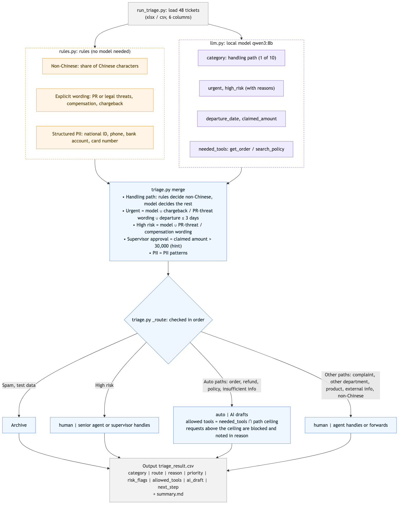

# Ticket Triage PoC

Implements ticket triage — the first stage of the [rollout](../docs/case-study.md#27-rollout-order) and the front half of the [end-to-end workflow](../docs/case-study.md#41-end-to-end-workflow) — on 48 sample tickets: decide each ticket's handling path, urgency, and risk, then set its route, the lookup tools AI may use, whether AI drafts, and the next step. **`route = auto` does not mean sending automatically: AI may look up data and draft, but an agent reviews before anything is sent.**

The tickets are in Traditional Chinese, so the model prompt and the agent-facing `reason` column are in Chinese as well; structured columns use English codes.

## How to run

Requirements: Python 3.9+, [Ollama](https://ollama.com/download), and the model:

```bash
ollama pull qwen3:8b    # about 5.2 GB
```

```bash
git clone https://github.com/wei-yiting/travel-support-ai-case-study.git
cd travel-support-ai-case-study/poc
python3 -m venv .venv
source .venv/bin/activate
pip install -r requirements.txt
python run_triage.py
```

- On a 16 GB M2, 48 tickets take about 9–12 minutes depending on load. Results are reproducible (temperature 0, fixed seed).
- Without Ollama or the model, the program exits and prints the command to run.
- Optional: `python -m unittest -v` runs unit tests for the rules, merge, and routing logic without calling the model.

## Output

The run writes `output/triage_result.csv` (48 rows) and `output/summary.md` (category distribution, human-handling share, data issues). Columns in `triage_result.csv`:

| Column | Values | Meaning |
|---|---|---|
| `ticket_id` | `TK-1001`, … | Ticket ID |
| `category` | `order`, `refund_cancel`, `policy`, `insufficient_info`, `complaint`, `other_department`, `product`, `external_info`, `non_chinese`, `spam`, `test` | Handling path |
| `route` | `auto`, `human` | `auto` = AI may look up data and draft, agent reviews before sending; `human` = no AI draft, handled by people |
| `reason` | Chinese text | Rationale shown to agents; every judgment is labeled as coming from the model, rules, or code |
| `priority` | `urgent`, `normal` | Priority, which sets queue order |
| `risk_flags` | `high_risk`, `supervisor_approval`, `pii` (multiple allowed) | Risk flags |
| `allowed_tools` | `get_order`, `search_policy` (multiple allowed) | Lookup tools AI may use when drafting |
| `ai_draft` | `true`, `false` | Whether AI drafts a reply |
| `next_step` | `agent_review_then_send`, `agent_review_then_supervisor`, `senior_agent_handles`, `agent_handles`, `forward_to_department`, `archive` | Next step |

Multi-value columns are separated by `;` and left empty when there is no value.

## Data issues found and how they were handled

**Preprocessing noise**

| Finding | Tickets | Handling |
|---|---|---|
| Test data, spam (gambling ads) | TK-1041, TK-1008 | Classified by the model and archived |
| Same customer writing in twice | TK-1013, TK-1031 | Not merged, triaged separately (not implemented in the PoC; the design links open tickets from the same customer, see the case study) |
| HTML `<br>` tags and mobile signatures | TK-1020 | Left as is |
| Full-width digits, repeated whitespace and punctuation, typos | TK-1007, TK-1035 | Left as is (does not affect the model) |

**Looks like noise but is a business case, so classification handles it**

| Finding | Tickets | Handling |
|---|---|---|
| Very short body | TK-1033 | → `insufficient_info` |
| English ticket | TK-1012 | → `non_chinese` (rule-based) |
| Body contains national ID, phone, bank account | TK-1023 | → `pii` flag |

`data/manual_labels.csv` holds the author's analysis notes, not agent triage results, and is not used to compute accuracy.

## Classification approach and why

Judgments that need language understanding go to the model; fixed formats and business thresholds go to rules and code, with rules acting only as a floor. The diagram shows how one ticket is processed: rules and the local model judge independently, the results are merged, and route and tools are decided in order.



| Component | Responsible for |
|---|---|
| Model (`llm.py`) | The three triage dimensions — handling path, urgency, high risk — each defined once in business terms; extracting the departure date and the amount the customer claims; requesting the lookup tools a draft needs |
| Rules (`rules.py`) | Non-Chinese (share of Chinese characters); explicit high-risk and chargeback wording (consumer protection office, lawyer, compensation, chargeback, etc.), which the model cannot override; personal-data patterns (national ID, phone, bank account, card number) |
| Code (`triage.py`) | Departure within 3 days and amount above 30,000 thresholds; urgency and high risk as the union of all sources; table lookups by handling path and flags to decide route, tool ceiling, and other columns |

| Handling path (`category`) | route | Tool ceiling (set by code) | ai_draft | next_step |
|---|---|---|---|---|
| Order lookup / change (`order`) | auto | get_order, search_policy | true | `agent_review_then_send` |
| Refund / cancellation (`refund_cancel`) | auto | get_order, search_policy | true | `agent_review_then_send` |
| Policy question (`policy`) | auto | search_policy | true | `agent_review_then_send` |
| Insufficient info (`insufficient_info`) | auto | get_order | true (asks the customer for details) | `agent_review_then_send` |
| Complaint and compensation (`complaint`), product (`product`), external info (`external_info`), non-Chinese (`non_chinese`) | human | none | false | `agent_handles` |
| Other department (`other_department`) | human | none | false | `forward_to_department` |
| Spam (`spam`), test data (`test`) | auto | none | false | `archive` |

`allowed_tools` = tools the model requested ∩ this ceiling. Requests above the ceiling are blocked and written into `reason`. `get_order` only reads the sender's own orders (ownership must be verified). Write actions such as submitting refunds are not AI tools; agents perform them. For insufficient info, the sender's own orders are checked first, and the customer is asked for details only if that is not enough.

`_route` decides in this order:

1. `spam` / `test` → `archive`
2. `high_risk` → regardless of handling path: human, `senior_agent_handles`, no draft
3. Otherwise by the table above; with `supervisor_approval`, only `next_step` changes to `agent_review_then_supervisor`

`supervisor_approval`: an amount above 30,000 claimed by the customer is only a hint. The actual refund depends on the order and policy, so the real check happens after the order lookup. `pii` is a flag only, reminding agents not to repeat the data in full when replying.

## What this PoC deliberately does not do

**Design decisions**

1. **No prompt tuning to improve triage results:** without discovery or labeled data there is no ground truth and no metric to optimize; the goal here is to build the structure.
2. **No expanding rule keywords:** rules are only a floor, and misses are covered by the model through the union. Keywords should be set after discovery, with more data and agent experience; for now only generic explicit wording is included to demonstrate the mechanism.

**Out of scope**

- No draft generation: drafting is a later rollout stage that needs order-API access and curated policy knowledge
- Lookup tools are declared but not implemented: no API access
- No linking of open tickets and no re-triage after details arrive: no ticketing system
- No sending email and no writes to any system

## Design trade-offs

| Decision | Gave up | Why it is worth it |
|---|---|---|
| Local qwen3:8b | Judgment quality, speed | Legal prohibits sending personal data to unreviewed, uncontracted external services, and no LLM provider is contracted, so this is the only compliant option until the review is done. qwen3:8b has strong Chinese, runs on a 16 GB M2, and supports JSON-schema structured output |
| Code sets the tool ceiling per handling path; the model can only request | Model autonomy; opening a new need (e.g. policy lookups for insufficient-info tickets) requires a code change | Permission control matters more than autonomy: AI reads customer-written content, and limited tools cap the blast radius of a prompt injection. The 11 blocked requests in this run (8 tickets) were all on human paths |
| Urgency and high risk as a union | Over-flagging uses up the urgent queue and senior agents | Missing one costs more |
| Flag personal data, do not mask it | Personal data remains in the output | Output only goes back to internal systems; masking tools cannot guarantee full coverage; if an external service is adopted later, legal decides whether to mask |
| No confidence score | One less sorting signal | The model's self-reported scores are uncalibrated and would be misused as thresholds |

## Known limitations

| Limitation | Impact | How to address |
|---|---|---|
| Handling paths, lookup tools, and permission splits are assumptions; the real process is unknown | Tools may need to be split, e.g. `search_policy` by knowledge type, or permissions by order type; the path list and ceiling table may change | Discovery plus IT's API inventory; the ceiling is a table and cheap to change |
| No real labels | No accuracy figure. Even if all 48 were correct, the rule of three only supports an error rate below about 6%, which cannot prove zero misclassified archives or forwards | The evaluation set in next step 1, plus per-ticket human confirmation in next step 3 |
| Handling-path definitions were written after reading these 48 tickets | Results are optimistic | The evaluation set must use unseen tickets |
| Model urgency is too broad: of 12 urgent tickets, 5 were flagged by the model alone, and TK-1002 (cancellation departing in 10 days), TK-1004 (phone complaint), TK-1010 (invoice reissue), and TK-1028 (correction departing in 14 days) do not need same-day handling | Uses up the urgent queue | Calibrate on the evaluation set |
| What customers write differs from what they need (TK-1004 complains nobody answers the phone but actually asks about the itinerary; classified as `complaint` here) | Wrong handling path | Improve with examples labeled in discovery, not with rules |
| Some path boundaries are unreliable: existing customers asking about their own orders classified as `policy` (TK-1009, TK-1022, TK-1035); vendor quotes and corporate group inquiries classified as `product` (TK-1006, TK-1017) | Wrong tools, or not forwarded to the right department | Refine definitions with discovery examples; check each path during evaluation |
| The model requests too few tools (TK-1007 rescheduling did not request `search_policy`; TK-1033 was `insufficient_info` but did not request `get_order`) | Drafts may lack a policy basis or miss filling gaps from the order | Check tool requests during evaluation |
| The local model is slow without a GPU or enough memory | — | Production deployment, see next step 2 |

## Top three steps toward production

1. **Build an evaluation set from discovery and validate the model + prompt combination.**
   Senior agents label real historical tickets. Proceed only after meeting the PoC promotion criteria in the case study (triage error ≤ 10%; zero missed urgent tickets, spam misclassifications, and wrong-department forwards).

2. **Decide how to deploy the model and observability.**
   Observability can be self-hosted inside the company (e.g. Langfuse, Arize Phoenix) so full traces stay internal, but maintenance cost and whether retention and audit features need a paid tier must be assessed. An external service requires legal and security review and should receive only content-free data. The model likewise is chosen between on-prem deployment and a reviewed external service. Can run in parallel with step 1.

3. **Integrate with the ticketing system and run in shadow mode.**
   Triage results are advisory only; agents mark them right or wrong, and every archived or forwarded ticket is confirmed by a person.
